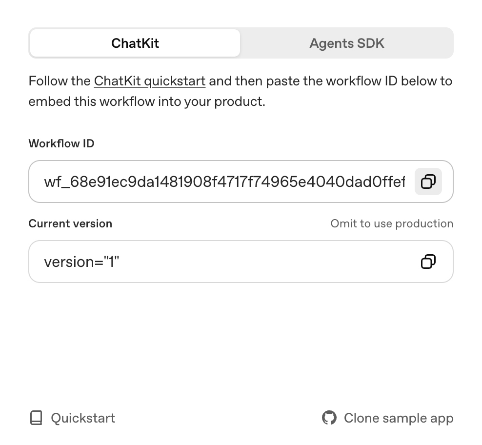

# Gap Analysis

[](LICENSE)


Next.js chat app for an OpenAI [ChatKit](http://openai.github.io/chatkit-js/) workflow. It creates a ChatKit session, accepts file uploads, and renders assistant replies in the page. When a reply is JSON from a gap-analysis workflow, it is shown as a summary, a list of gaps, recommendations, and a download link when the payload includes one.

## What You Get

- Chat UI using the `<openai-chatkit>` web component, with file uploads enabled
- API endpoint for creating a session at [`app/api/create-session/route.ts`](app/api/create-session/route.ts)
- Start-screen greeting, starter prompts, placeholder text, and theme in [`lib/config.ts`](lib/config.ts)
- Reply formatting in [`hooks/useMessageFormatter.ts`](hooks/useMessageFormatter.ts): gap-analysis JSON becomes a summary, **Identified Gaps**, **Recommendations**, and a download button when `updated_file` is present; other replies are rendered as Markdown

## Getting Started

### 1. Install dependencies

```bash
npm install
```

### 2. Create your environment file

Copy the example file and fill in the required values:

```bash
cp .env.example .env.local
```

You can get your workflow id from the [Agent Builder](https://platform.openai.com/agent-builder) interface, after clicking "Publish":



You can get your OpenAI API key from the [OpenAI API Keys](https://platform.openai.com/api-keys) page.

### 3. Configure ChatKit credentials

Update `.env.local` with the variables that match your setup.

- `OPENAI_API_KEY` — This must be an API key created **within the same org and project as your Agent Builder workflow**. If a different `OPENAI_API_KEY` is already set in your terminal, that value takes precedence over `.env.local`. Clear it first: `unset OPENAI_API_KEY` in bash, or `set OPENAI_API_KEY=` in Windows Command Prompt. In PowerShell, run `Remove-Item Env:OPENAI_API_KEY`.
- `NEXT_PUBLIC_CHATKIT_WORKFLOW_ID` — The workflow id from [Agent Builder](https://platform.openai.com/agent-builder), which starts with `wf_...`
- (optional) `CHATKIT_API_BASE` — A custom base URL for the ChatKit API endpoint

> If the workflow uses a model that requires organization verification, such as GPT-5, verify the organization first. Open [organization settings](https://platform.openai.com/settings/organization/general) and click "Verify Organization".

### 4. Run the app

```bash
npm run dev
```

Visit `http://localhost:3000` and start chatting. Use the start-screen prompt to confirm the workflow is connected. Change the greeting or prompts in [`lib/config.ts`](lib/config.ts), and the panel behavior in [`components/ChatKitPanel.tsx`](components/ChatKitPanel.tsx).

### 5. Deploy the app

```bash
npm run build
```

Before deploying, add the app domain to the [domain allowlist](https://platform.openai.com/settings/organization/security/domain-allowlist).

## Customization

- Adjust starter prompts, greeting text, the [ChatKit theme](https://chatkit.studio/playground), and placeholder copy in [`lib/config.ts`](lib/config.ts).
- Change how gap-analysis JSON is displayed in [`hooks/useMessageFormatter.ts`](hooks/useMessageFormatter.ts). Expected fields are `gap_analysis_summary`, `gaps`, `recommendations`, and `updated_file`.
- Update session setup, attachments, and client tools (`switch_theme`, `record_fact`) in [`components/ChatKitPanel.tsx`](components/ChatKitPanel.tsx).

## References

- [ChatKit JavaScript Library](http://openai.github.io/chatkit-js/)
- [Advanced Self-Hosting Examples](https://github.com/openai/openai-chatkit-advanced-samples)
